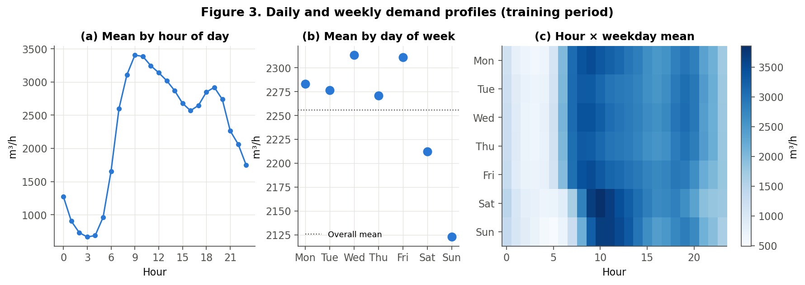
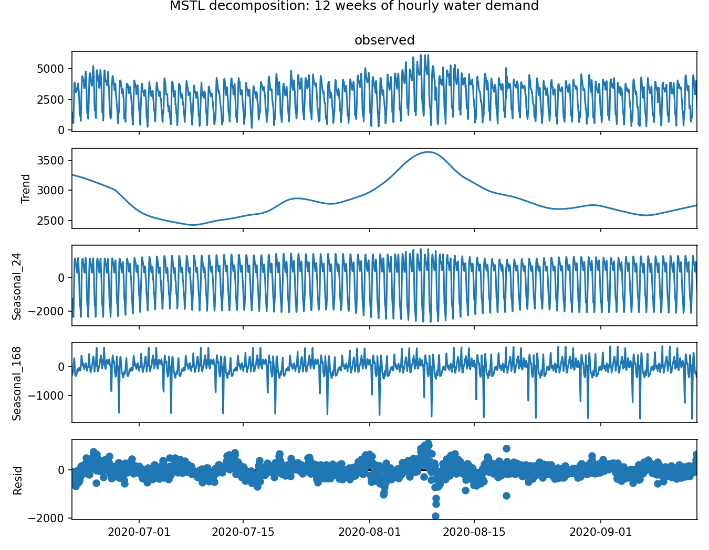
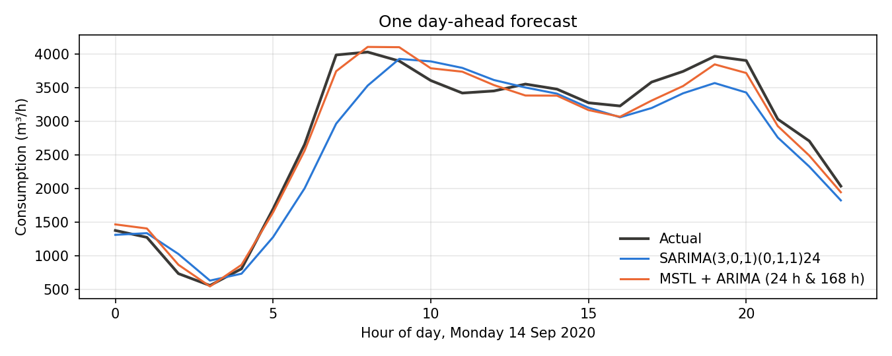
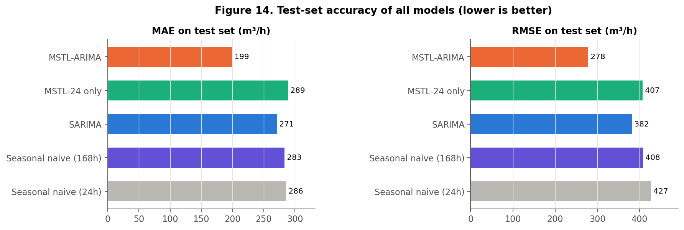

# Forecasting Urban Water Demand: Applying SARIMA and Multi-Seasonal Decomposition in Python

*A worked example with real hourly data from a German water network*

## Why forecast water demand by the hour?

When you open a tap, the water usually comes from a storage tank that a pump filled hours earlier. Utilities plan those pump runs a day in advance. Pumping at the wrong time wastes electricity, and filling tanks too little risks low pressure. So a good estimate of tomorrow's demand, hour by hour, is a useful planning input. In this post I show how two classical time-series tools, SARIMA and MSTL decomposition, handle that task on real data, and why the choice between them matters.

## Seasonality: patterns that repeat on a clock

A time series is a set of measurements in time order. Water demand is a textbook example of **seasonality**: patterns that repeat with a fixed period. Here there are two:

- a **daily cycle** (period 24 hours): very low use at 3 a.m., a steep rise from 6 a.m. and a peak around 9 a.m.;
- a **weekly cycle** (period 168 hours): on Saturdays and Sundays the morning rise starts later and peaks higher.

The weekly effect is easy to miss, because the weekend *average* is only about 5% lower than a weekday's. What changes is the *shape* of the day.


*Figure 1. Average demand by hour, by weekday, and hour × weekday (training data). Note the later weekend morning peak in the heat map.*

## The two methods

**SARIMA** (seasonal ARIMA) predicts the next value from recent values and recent errors, after removing a repeating pattern by *seasonal differencing*: subtracting the value one season earlier. With hourly data the natural season is s = 24, so the model compares each hour with the same hour yesterday. A SARIMA model has one seasonal period. If yesterday was a Sunday and today is a Monday, the model starts from the wrong kind of day.

**MSTL** (Multiple Seasonal-Trend decomposition using Loess) splits a series into a trend, *one seasonal component per period* and a remainder: y = trend + daily + weekly + remainder. MSTL does not forecast on its own, so we add three steps: repeat each seasonal component's latest cycle into the future, forecast the seasonally adjusted part (trend + remainder) with a small ARIMA model, and add everything back.

## The data

I used the open dataset *Hourly Water Demand of a Mixed District Recorded by Supplier* (Weyrauch et al., 2024, Zenodo, CC-BY 4.0). It contains 46,032 hourly readings from January 2016 to April 2021 at a pumping station serving homes, shops and industry in Germany. The publisher also provides a cleaned version in which every day has exactly 24 hours (daylight-saving changes fixed). That regular grid matters when you use seasonal periods of 24 and 168.

## A worked example in Python

The snippet below loads the data, decomposes the last 12 weeks before a forecast day and builds both forecasts for the next 24 hours. It uses pandas and statsmodels 0.14 and runs as shown.

```python
import pandas as pd
from statsmodels.tsa.seasonal import MSTL
from statsmodels.tsa.arima.model import ARIMA
from statsmodels.tsa.statespace.sarimax import SARIMAX

df = pd.read_csv("waterconsumption_noNaN_fixedTimechange.csv")
hour = df["Time"].str.strip().str[:2].astype(int)
df.index = pd.to_datetime(df["Date"], format="%m/%d/%Y") + pd.to_timedelta(hour, unit="h")
y = df["Consumption"].asfreq("h")

origin = pd.Timestamp("2020-09-14 00:00")          # forecast this Monday
hist = y[origin - pd.Timedelta(weeks=12):origin - pd.Timedelta(hours=1)]

# Enhanced model: MSTL + ARIMA
res = MSTL(hist, periods=(24, 168), stl_kwargs={"seasonal_deg": 0}).fit()
s24, s168 = res.seasonal["seasonal_24"], res.seasonal["seasonal_168"]
season_next = s24.values[-24:] + s168.values[-168:-144]
adjusted = hist - res.seasonal.sum(axis=1)
mstl_fc = ARIMA(adjusted.values, order=(1, 1, 1)).fit().forecast(24) + season_next

# Baseline: SARIMA(3,0,1)(0,1,1) with s = 24
sarima = SARIMAX(hist[-4*168:], order=(3, 0, 1), seasonal_order=(0, 1, 1, 24)).fit(disp=False)
sarima_fc = sarima.forecast(24)
```

**What the code does.** The `Time` column holds intervals such as "07:00-08:00", so we take the first two characters as the hour and build a proper hourly timestamp. `hist` contains only data *before* midnight of the forecast day, which prevents information from the future leaking into the model. `MSTL(..., periods=(24, 168))` returns one seasonal column per period. Repeating the last 24 values of the daily component and the matching 24 values from one week earlier gives tomorrow's seasonal shape. ARIMA(1,1,1) then forecasts what is left. The SARIMA orders were chosen in the full project from the ACF/PACF plots and validation accuracy.


*Figure 2. MSTL splits 12 weeks of demand into trend, daily (24 h) and weekly (168 h) components and a remainder.*


*Figure 3. Monday 14 September 2020. SARIMA (blue) copies Sunday's late morning rise; MSTL + ARIMA (orange) remembers last Monday.*

## Does it hold up beyond one day?

A single day proves little, so the full project repeated this every day for 288 days that no model had seen during tuning (June 2020 – April 2021): 6,912 hourly forecasts. Mean absolute error (MAE) fell from 270.7 m³/h for SARIMA to 199.1 m³/h for MSTL + ARIMA, a 26.4% reduction. RMSE fell 27.3% and MAPE fell from 15.9% to 11.2%. A Diebold–Mariano test showed the difference is very unlikely to be chance. Most of the gain came on weekends and around 7 a.m. When I removed the weekly component and kept everything else the same, the error was *worse* than SARIMA's (MAE 288.8). The weekly pattern is what made the difference.


*Figure 4. Test-set MAE and RMSE for all models, including two seasonal-naive benchmarks.*

## Real-world use, society and the SDGs

A more accurate day-ahead forecast can help operators plan pump schedules and tank levels, for example by preparing for the weekend morning peak instead of assuming every day looks like yesterday. This links to **UN Sustainable Development Goal 6 (Clean Water and Sanitation)**, which includes efficient water use and sound management of water resources, and indirectly to energy efficiency. To be clear about the evidence: this study measured forecast accuracy, not energy or water savings. Those benefits are possible, but they would need a separate study. The method also has limits: one district, a test period that overlaps the 2020–21 pandemic, and no weather inputs. The largest remaining errors were hot summer evenings.

## Conclusion

Hourly water demand has more than one rhythm. A single-season SARIMA captures the daily cycle but treats Monday like Sunday. Splitting the series into daily and weekly components with MSTL, and forecasting only what remains, is a small change in Python with a large effect on accuracy. Try it on your own time series: first plot demand by hour *and* by weekday, and check whether there is a second rhythm hiding in your data.

## References

1. Weyrauch, A. et al. (2024). *Hourly Water Demand of a Mixed District Recorded by Supplier* [Dataset]. Zenodo. https://doi.org/10.5281/zenodo.11045013
2. Bandara, K., Hyndman, R. J., & Bergmeir, C. (2021). MSTL: A seasonal-trend decomposition algorithm for time series with multiple seasonal patterns. arXiv:2107.13462.
3. Arandia, E., Ba, A., Eck, B., & McKenna, S. (2016). Tailoring seasonal time series models to forecast short-term water demand. *J. Water Resour. Plann. Manage.*, 142(3), 04015067.
4. Taylor, J. W. (2003). Short-term electricity demand forecasting using double seasonal exponential smoothing. *J. Oper. Res. Soc.*, 54(8), 799–805.
5. Hyndman, R. J., & Athanasopoulos, G. (2021). *Forecasting: Principles and Practice* (3rd ed.). OTexts. https://otexts.com/fpp3/
6. Seabold, S., & Perktold, J. (2010). statsmodels: Econometric and statistical modeling with Python. *Proc. 9th Python in Science Conf.*
7. United Nations (2015). *Transforming our world: the 2030 Agenda for Sustainable Development*, Goal 6.
